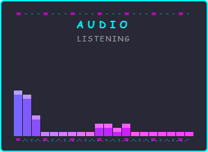

# Timbre

A **Streamer.bot-native microphone audio visualizer** for OBS — 52 hand-built canvas/WebGL
effects in one overlay, driven live from a browser control panel (usable as an OBS dock).
**No dedicated server**: the overlay captures its own microphone with the Web Audio API,
and Streamer.bot's built-in HTTP + WebSocket servers do the hosting and config relay.



## How it works

```
control.html ── DoAction "Timbre Push" {config} ──► Streamer.bot (C# caches + broadcasts)
                                                        │ General.Custom
                                                        ▼
                                    overlay page (OBS Browser Source)
                                    ├─ getUserMedia + AnalyserNode  ← its OWN mic capture
                                    └─ 52 self-registering effect factories
```

- **No audio crosses any wire.** Each overlay page runs its own `getUserMedia` →
  `AnalyserNode` (fftSize 2048, folded into 32 bands from 60 Hz to 12 kHz, ~30 fps; beside
  them the 32 values 750 Hz apart that effects built earlier were tuned on). Only the
  settings JSON travels, via Streamer.bot.
- **One config message** (`timbre:config`) carries everything: active effect, global knobs,
  scene placement, the afterglow length, per-effect knobs, the mic device to capture, and
  whether the browser processes it. **Microphone processing** on (the default) is the browser's
  echo cancellation, noise suppression and automatic gain; off is the raw microphone, which
  is truer to the sound but lets room noise through in quiet moments.
- **Sync-on-connect:** when a page connects it fires `DoAction "Timbre Push"`, and the
  C# action re-broadcasts the saved config — a source added mid-stream paints correctly.
- All names/defaults/ranges live in one file (`shared/viz-config.js`) used by the overlay,
  the control panel, and the verify suites.

## Quick start (no Streamer.bot needed)

First, get the code — either `git clone https://github.com/FlashGalatine/timbre-visualizer.git`
or click **<> Code → Download ZIP** on the repo page and extract it. You need Node.js 20
or later. Then, inside the folder:

```
npm install
npm start          # mock Streamer.bot on :7474 (HTTP) + :8080 (WS)
```

Open `http://127.0.0.1:7474/` and launch the control panel + an overlay from the index.
The overlay will ask for mic permission in a normal browser.

The mock uses Streamer.bot's own default ports, so it cannot start while Streamer.bot is
running on them. Close Streamer.bot first, or give the mock other ports with the
`SB_HTTP_PORT` and `SB_WS_PORT` environment variables.

## Quick start (real Streamer.bot)

See **[docs/SETUP.md](docs/SETUP.md)**. Summary: map four HTTP-server folders
(`timbre-overlay`, `timbre-shared`, `timbre-control`, `timbre-spike`), create one action
named exactly **`Timbre Push`** with the C# in [actions/timbre-push.cs](actions/timbre-push.cs),
put that action in a blocking action queue (the setup guide says why),
then add `http://127.0.0.1:7474/timbre-overlay/mic-visualizers-300x220.html` (or the
4:3 `mic-visualizers-1440x1080.html` / 16:9 `mic-visualizers-1920x1080.html` pages, which
scale to whatever size you give the Browser Source — 720×540, 1280×720, 960×540 …) as an
OBS Browser Source and
`.../timbre-control/control.html` as a Custom Browser Dock.

> **First: run the mic spike.** OBS's embedded browser has no permission prompt; add
> `.../timbre-spike/mic-test.html` as a Browser Source once to confirm it auto-grants
> the microphone on your OBS build (see docs/SETUP.md → "CEF mic check").

## The 52 effects

32 canvas-2D + 20 WebGL (three.js, vendored — works offline). Includes spectrum bars,
waveforms, matrix rain with custom text, seasonal/holiday scenes, Pride flags, and
floating 3D scenes that answer the voice (a rose that blooms, birds on a wire, a school
of fish, a Christmas tree whose lights carry your voice). Add your own: drop a factory file in `overlay/factories/`, register it in
`shared/viz-config.js`, add a `<script>` tag to the three overlay pages — see [docs/EFFECTS.md](docs/EFFECTS.md).

## Verification

```
npm run verify           # under Node, no browser: the settings tables, config handling, the effects' arithmetic, the transport and the dock's logic, against a mock of Streamer.bot
npm run verify:render    # in the Edge or Chrome on the machine, with a fake microphone: what the pages draw, and the dock operated by mouse and keyboard
npm run verify:cs        # Windows only: compiles the C# action and runs its accept/reject cases
```

`npm install` brings `playwright-core`, which `verify:render` drives. It uses the Edge or Chrome
already on the machine and downloads no browser. `verify:cs` needs `csc.exe` from the .NET
Framework and is not part of `npm run verify`.

`verify` and `verify:render` run against `mock-sb-server.mjs`, not against Streamer.bot.
Each starts its own mock on side ports (7476 and 8090), and stops with a message if
something already answers there. The mock models these things, as they were measured on
Streamer.bot 1.0.7:

- The reply to a `DoAction` is sent when the action is queued, not when it has run, and
  it names the queue the action is in.
- An action that does not exist gets Streamer.bot's error reply.
- A sync replay is broadcast to every connected page, not only to the one that asked.
- The action's checks: the mock runs a line-for-line copy of `actions/timbre-push.cs`,
  refuses what the action refuses with the same error codes, and stores a config as it
  was sent.
- An overlap mode, off by default: two requests for `Timbre Push` that arrive together
  run with one request's arguments, which is what Streamer.bot's default queue does.

It does not model:

- Streamer.bot's own C# compiler. `verify:cs` compiles the action with the .NET
  Framework's compiler against a stand-in for `CPH`; compiling it in Streamer.bot is
  still the test that counts.
- Real timing. The mock answers at once, or after a fixed delay a test sets.
- OBS's browser. The render suite drives Edge or Chrome with a fake microphone that is
  always granted, so the microphone check in docs/SETUP.md still has to be done in OBS.

### What a change to the audio input does to the effects

`tools/compare-input.mjs` is a development script. It feeds the same recorded signals, sample
for sample, to two builds of the overlay (a git ref, and the working tree) through the real
`AnalyserNode` of each, and reports per effect the levels each reader derives from the sound
and the pixels that differ:

```
node tools/compare-input.mjs --ref <git ref> --out <folder>
```

- The signals (made in `tools/input-replay.mjs`): a speech-like
  voice at 150 Hz and one at 220 Hz, a kick with a hi-hat, a simple band (bass notes, chords,
  hi-hats), a tone rising from 60 Hz to 12 kHz, and silence. Six seconds each.
- `levels.txt`: the 32 values of each build, and every reader's level old against new with
  its limit (`tools/input-readers.mjs` lists the readers; `npm run verify` checks that each
  line it mirrors is still in the effect's file).
- `compare.txt`: per effect, the share of pixels that differ and the change in light, sorted
  from most changed to least. `sheets/<effect>.png`: old on the left, new on the right.
- It serves the pages itself on the suites' side port (7476), so it must not run while a
  suite does. It never contacts Streamer.bot.

`npm run verify:render` uses the same signals: it records the speech and the sweep through
the real analysis, checks the slices against a 64-point `AnalyserNode`, and holds a frame of
18 effects (at least two for each way of reading the sound) to the numbers stored in
`tools/input-expectations.json`. After a look is changed on purpose, write them again with
`node tools/compare-input.mjs --steps record,render,expect` and say so in the change.

## Author & support

Built by **Ashe "Flash" Galatine**.

- Email — [AsheJunius@gmail.com](mailto:AsheJunius@gmail.com)
- X — [@FlashGalatine](https://x.com/FlashGalatine) · BlueSky — [@projectgalatine.com](https://bsky.app/profile/projectgalatine.com)
- Twitch — [FlashGalatine](https://www.twitch.tv/FlashGalatine) · Discord — [Project Galatine](https://discord.gg/K6pRfSvu2Q)
- Support — Patreon [ProjectGalatine](https://www.patreon.com/ProjectGalatine) · CashApp [$ProjectGalatine](https://cash.app/$ProjectGalatine)

## License

MIT — see [LICENSE](LICENSE). Third-party: three.js (MIT) and the Audiowide font
(SIL OFL 1.1) — see [THIRD_PARTY_NOTICES.md](THIRD_PARTY_NOTICES.md). Their licence texts
are `overlay/vendor/LICENSE-three.txt` and `overlay/fonts/OFL.txt`.
