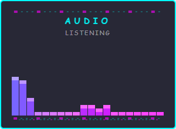

# Timbre

A **Streamer.bot-native microphone audio visualizer** for OBS — 49 hand-built canvas/WebGL
effects in one overlay, driven live from a browser control panel (usable as an OBS dock).
**No dedicated server**: the overlay captures its own microphone with the Web Audio API,
and Streamer.bot's built-in HTTP + WebSocket servers do the hosting and config relay.



## How it works

```
control.html ── DoAction "Timbre Push" {config} ──► Streamer.bot (C# caches + broadcasts)
                                                        │ General.Custom
                                                        ▼
                                    overlay page (OBS Browser Source)
                                    ├─ getUserMedia + AnalyserNode  ← its OWN mic capture
                                    └─ 49 self-registering effect factories
```

- **No audio crosses any wire.** Each overlay page runs its own `getUserMedia` →
  `AnalyserNode` (fftSize 64, ~30 fps). Only the settings JSON travels, via Streamer.bot.
- **One config message** (`timbre:config`) carries everything: active effect, global knobs,
  the shared 3D-model knob group, per-effect knobs, and the mic device to capture.
- **Sync-on-connect:** on WebSocket open the overlay fires `DoAction "Timbre Push"`, and the
  C# action re-broadcasts the cached config — a source added mid-stream paints correctly.
- All names/defaults/ranges live in one file (`shared/viz-config.js`) used by the overlay,
  the control panel, and the verify suites.

## Quick start (no Streamer.bot needed)

First, get the code — either `git clone https://github.com/FlashGalatine/timbre-visualizer.git`
or click **<> Code → Download ZIP** on the repo page and extract it. Then, inside the folder:

```
npm install
npm start          # mock Streamer.bot on :7474 (HTTP) + :8080 (WS)
```

Open `http://127.0.0.1:7474/` and launch the control panel + an overlay from the index.
The overlay will ask for mic permission in a normal browser.

## Quick start (real Streamer.bot)

See **[docs/SETUP.md](docs/SETUP.md)**. Summary: map four HTTP-server folders
(`timbre-overlay`, `timbre-shared`, `timbre-control`, `timbre-spike`), create one action
named exactly **`Timbre Push`** with the C# in [actions/timbre-push.cs](actions/timbre-push.cs),
then add `http://127.0.0.1:7474/timbre-overlay/mic-visualizers-300x220.html` (or the
4:3 `mic-visualizers-1440x1080.html` / 16:9 `mic-visualizers-1920x1080.html` pages, which
scale to whatever size you give the Browser Source — 720×540, 1280×720, 960×540 …) as an
OBS Browser Source and
`.../timbre-control/control.html` as a Custom Browser Dock.

> **First: run the mic spike.** OBS's embedded browser has no permission prompt; add
> `.../timbre-spike/mic-test.html` as a Browser Source once to confirm it auto-grants
> the microphone on your OBS build (see docs/SETUP.md → "CEF mic check").

## The 49 effects

37 canvas-2D + 12 WebGL (three.js, vendored — works offline). Includes spectrum bars,
waveforms, matrix rain with custom text, seasonal/holiday scenes, pride ribbons, and
spinning 3D STL models with a shared knob group (rotation, position, clones, spark
particles). Add your own: drop a factory file in `overlay/factories/`, register it in
`shared/viz-config.js`, add a `<script>` tag — see [docs/EFFECTS.md](docs/EFFECTS.md).

## Verification

```
npm run verify           # 28 protocol/table tests against a faithful SB mock
npm run verify:render    # 14 real-pixel tests in system Edge/Chrome (fake mic device)
```

`verify:render` needs `npm install --no-save playwright-core`.

## Author & support

Built by **Ashe "Flash" Galatine**.

- Email — [AsheJunius@gmail.com](mailto:AsheJunius@gmail.com)
- X — [@FlashGalatine](https://x.com/FlashGalatine) · BlueSky — [@projectgalatine.com](https://bsky.app/profile/projectgalatine.com)
- Twitch — [FlashGalatine](https://www.twitch.tv/FlashGalatine) · Discord — [Project Galatine](https://discord.gg/K6pRfSvu2Q)
- Support — Patreon [ProjectGalatine](https://www.patreon.com/ProjectGalatine) · CashApp [$ProjectGalatine](https://cash.app/$ProjectGalatine)

## License

MIT — see [LICENSE](LICENSE). Third-party: three.js (MIT), Audiowide font
(SIL OFL 1.1), and the bundled rose STL model (CC-BY-4.0, same author, generated
with Meshy.ai) — see [THIRD_PARTY_NOTICES.md](THIRD_PARTY_NOTICES.md).
